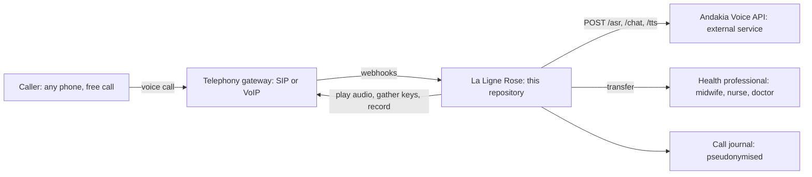

# La Ligne Rose

A free voice line where women and girls can ask health questions by phone, in
Wolof or in French, and be put through to a health professional when they need one.

This repository contains the phone line layer: incoming call webhooks, the
voice menu, routing between the voice assistant and a human, and the call
journal. Speech recognition, conversation and speech synthesis are provided
by the **Andakia Voice API**, an external service reached over HTTP.

## The problem

Many women and girls in Senegal have no reliable source of information about
their health: periods, pregnancy, contraception, infections, violence. The
information that exists is mostly written, mostly in French, and often online.
That leaves out those who:

- read little or not at all,
- speak Wolof, not French, in daily life,
- have a basic phone and no mobile data,
- cannot ask the question in front of their family or their community.

## What La Ligne Rose does

- **A phone call, nothing else.** Any phone works, including the most basic
  ones. No app, no internet, no reading. The number is meant to be toll-free.
- **Wolof first, French too.** The caller chooses with one key, or simply
  speaks: a caller who presses nothing is served in Wolof.
- **A voice assistant that answers**, from health content validated by
  professionals (content and answers are handled by the Andakia Voice API).
- **A human when it matters.** Key 0 at any moment, a request such as "I want
  to talk to a midwife", or any sign of emergency puts the caller through to a
  health professional.
- **Confidential by design.** The caller number is never stored, only a salted
  hash. Conversation transcripts are not stored unless consent is configured.

## How a call works

```text
Call answered
  Welcome (Wolof, then French): "free and confidential"
  Language menu: 1 Wolof, 2 French, no key = Wolof
  Main menu: 1 ask a question, 2 talk to a health professional, 9 repeat
             no key twice = go straight to the voice assistant

Voice assistant loop
  caller speaks  ->  /asr (audio to text)
                 ->  /chat (text to reply + flags: handoff, emergency)
                 ->  /tts (reply to audio)  ->  caller hears the answer
  key 0, request for a person, or emergency  ->  transfer to a professional
  no professional available  ->  the caller is told, and goes back to the menu
```

## Architecture



```text
  Caller ----call----> Telephony gateway ----webhooks----> La Ligne Rose
  (any phone)          (SIP / VoIP)      <---actions-----   (this repository)
                            |                                  |      |
                            |                     POST /asr    |      | call journal
                            |                     POST /chat   |      | (no numbers,
                            |                     POST /tts    v      |  no transcripts
                            |                     Andakia Voice API   |  by default)
                            |                     (external service)
                            |
                            +----transfer----> Health professional
```

| Part | Where | Role |
|---|---|---|
| Webhooks and call flow | `ligne_rose/app.py` | answers the gateway, runs menus and conversation turns |
| Voice menu messages | `ligne_rose/messages.py` | fixed sentences in Wolof and French |
| Routing | `ligne_rose/routing.py` | assistant or human, local emergency and handoff safety net |
| Voice API client | `ligne_rose/voice_api.py` | `POST /asr`, `/chat`, `/tts`, one retry on failure |
| Audio cache | `ligne_rose/media.py` | renders each sentence once, serves `/media/<key>.wav` |
| Call journal | `ligne_rose/call_log.py` | SQLite, pseudonymised, aggregated `/stats` |
| Gateway contract | `docs/gateway-contract.md` | webhooks and actions, vendor neutral |
| API contract and examples | `docs/api/` | JSON requests and responses for the 3 endpoints |
| Mock Voice API | `mock_api/server.py` | same 3 endpoints, canned answers, for local runs and tests |

### What is not in this repository

The Andakia Voice API (its models, training data, health content and
conversation logic) is proprietary and runs as a separate service. See
[NOTICE](NOTICE). This repository works with any service that implements the
contract in [`docs/api/`](docs/api/README.md), and runs fully offline with the mock.

## Run it locally

Requirements: Python 3.10 or newer, `curl`.

```bash
git clone https://github.com/andakia/la-ligne-rose.git
cd la-ligne-rose
python -m venv .venv && source .venv/bin/activate
pip install -r requirements.txt

pytest                      # 24 tests, against the mock Voice API
./scripts/run_local.sh      # starts the mock and the line, simulates a Wolof call
./scripts/run_local.sh fr   # same, French caller
```

Output of the simulated call (French):

```text
CALL sim-f723501c rings
   LINE  says : Bienvenue sur La Ligne Rose. Cet appel est gratuit et confidentiel.
   ...
CALLER presses 2
   LINE  says : Pour poser une question sur votre santé, tapez un. ...
CALLER presses 1
   LINE  says : Posez votre question après le bip. ...
CALLER says  : J'ai une question sur mes règles.
   LINE  says : Ceci est le service de test. Votre question est bien reçue. ...
   LINE  record: {'max_s': 20, 'silence_ms': 1500, 'beep': True, 'dtmf_interrupt': True}
CALLER says  : Je voudrais parler à une sage-femme.
   LINE  says : D'accord, je vous passe une professionnelle de santé.
   LINE  transfer: {'target': 'sip:health-desk@pbx.example.com'}
CALL sim-f723501c ends
```

To run the services by hand:

```bash
cp .env.example .env        # then edit
uvicorn mock_api.server:app --port 9000 &
ANDAKIA_API_URL=http://localhost:9000 python -m ligne_rose
python scripts/simulate_call.py --lang wo --say "Dama bëgg wax ak ab fajkat."
```

## Configuration

All settings are environment variables, see [.env.example](.env.example).

| Variable | Default | Meaning |
|---|---|---|
| `ANDAKIA_API_URL` | `https://api.example.com` | base URL of the Voice API |
| `ANDAKIA_API_KEY` | (empty) | API key, sent as a bearer token. Never commit it |
| `PUBLIC_BASE_URL` | `http://localhost:8080` | URL of this service as seen by the gateway |
| `HUMAN_TRANSFER_TARGET` | (empty) | where to transfer, for example a SIP URI. Empty = nobody available |
| `MAX_AI_TURNS` | `12` | assistant turns per call before a polite goodbye |
| `CALL_LOG_PATH` | `data/calls.sqlite3` | call journal |
| `CALLER_HASH_SALT` | (random per process) | salt for caller pseudonyms. Set it to keep them stable |
| `LOG_TRANSCRIPTS` | `false` | store what callers said. Only with explicit consent |
| `ADMIN_TOKEN` | (empty) | enables `GET /stats` with header `X-Admin-Token` |

## Privacy and safety

- Callers talk about their health. The journal keeps routes, turn counts,
  transfers and errors, not numbers and not words, unless `LOG_TRANSCRIPTS` is
  turned on for a consented study.
- Emergencies and requests for a person are detected twice: by flags from the
  Voice API and by a local keyword list in Wolof and French. The safer answer
  wins. When the Voice API is unreachable, the caller is put through to a
  professional, never left in silence.
- The voice menu wording and the keyword lists are drafts. They must be
  reviewed with native speakers and the health partners before launch.

## Status

Working prototype of the line layer, tested end to end against the mock.
Next steps: an adapter for the chosen telephony gateway, the toll-free number,
a schedule for the health professionals' desk, and a pilot with consented callers.

## License

Apache License 2.0, see [LICENSE](LICENSE). The Andakia Voice API and its
models are proprietary and not part of this repository, see [NOTICE](NOTICE).
